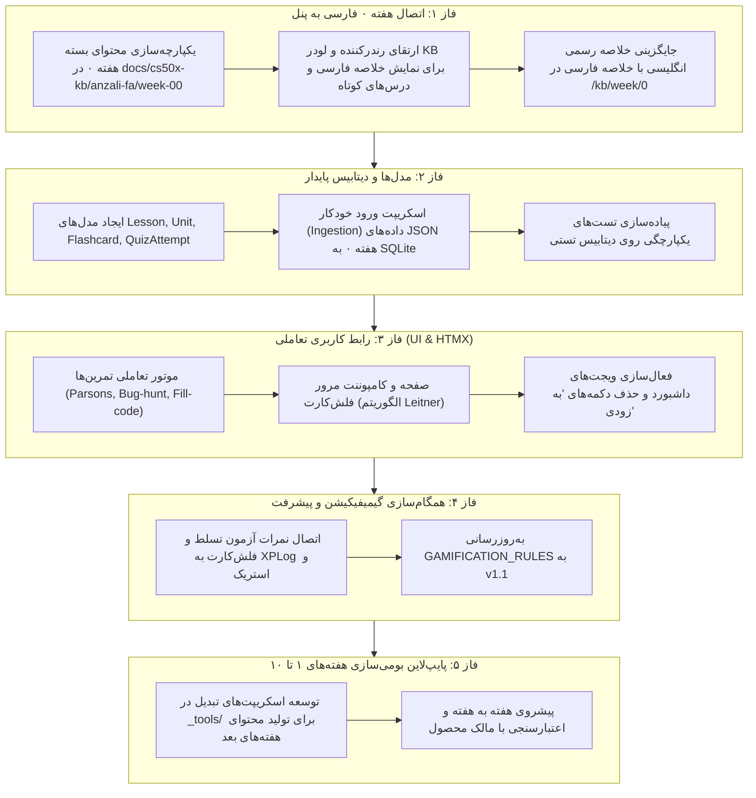

# گزارش ممیزی جامع پایگاه دانش و رابط کاربری (فاز ۰)
**پروژه:** Anzali-CS50-Hub (CS50x Anzali)  
**تاریخ گزارش:** ۲۷ اکتبر ۲۰۲۶  
**نویسنده:** Senior Engineer / Curriculum & Learning Experience Designer  
**مخاطب:** Sina (مالک محصول)  
**وضعیت:** فاز ۰ (فقط خواندن و ممیزی تحلیلی — بدون هیچ تغییر در پایگاه کد یا سرور عملیاتی)  
**شاخص برچسب‌های گزارش:**
- **[تأییدشده]**: با آزمایش مستقیم روی سایت محلی (localhost:5000)، بازرسی دقیق کد پایتون یا فایل‌های مخزن بررسی و اثبات شده است.
- **[استنباط]**: بر اساس ساختار داده‌ها، مدل‌های ذهنی، معماری و کدهای وابسته به صورت منطقی نتیجه‌گیری شده است.
- **[نامشخص]**: نیاز به تصمیم‌گیری صریح یا بررسی محیط تولید و داده‌های سرور زنده دارد.

---

## ۱. خلاصه مدیریتی (Executive Summary)

پلتفرم فعلی `Anzali-CS50-Hub` یک هسته نرم‌افزاری بسیار تمیز، سریع و سبک بر پایه Flask + Jinja2 + HTMX + Tailwind با هویت بصری هاروارد (Crimson `#A51C30`) دارد **[تأییدشده]**. با این حال، بین «آنچه در ظاهر پنل و مستندات وعده داده می‌شود» و «محتوای واقعی پایگاه دانش» یک شکاف بزرگ و عمیق آموزشی وجود دارد **[تأییدشده]**:

1. **پایگاه دانش فعلی عملاً انگلیسی است:** ۳۳۲ سند از ۳۹۷ سند درخت پایگاه دانش مستقیماً انگلیسی و متن دست‌نخورده هاروارد هستند؛ تنها در انتهای صفحات یک بخش تکمیلی چندخطی به نام `GENERATED (fa)` یا «کاربرد آموزشی» به فارسی چسبانده شده است **[تأییدشده]**.
2. **قابلیت‌های آموزشی وعده‌داده‌شده غیرفعال‌اند:** در داشبورد ۴ ابزار هوشمند (فلش‌کارت، تحلیل ضعف، چالش زمان‌دار، تایمر مطالعه) روی دکمه‌های خاکستری «به زودی» قفل هستند **[تأییدشده]**.
3. **گنجینه بسته آزمایشی هفته ۰ دست‌نخورده مانده است:** بسته بومی‌سازی‌شده هفته ۰ (واقع در `_incoming/cs50x-anzali-kb/`) شامل ۱۰ درس کوتاه، ۱۶ یادداشت عمیق فارسی، ۴۹ فلش‌کارت استاندارد Leitner/SM-2، ۴۶ سوال کوییز و چالش، و موتور گیمیفیکیشن کامل است؛ اما این محتواها در سیستم لودر فعلی بارگذاری نشده‌اند و در سایت دیده نمی‌شوند **[تأییدشده]**.
4. **رسانه‌های وابسته به اینترنت خارجی:** از ۱۴۸ تصویر موجود در پایگاه دانش، ۱۴۱ مورد به لینک‌های خارجی هاروارد وصل هستند که به دلیل فیلترینگ و نوسان شبکه در ایران ممکن است شکسته شوند و ۷ تصویر محلی نیز مفقودند **[تأییدشده]**.

---

## ۲. گردش صفحه به صفحه در سایت (UI & Experience Audit)

تست زنده روی `http://127.0.0.1:5000` با حساب‌های دانشجو (`student`) و مدرس (`admin`) انجام شد **[تأییدشده]**:

| صفحه / بخش | نقش | وضعیت فعلی و محتوا | مغایرت‌ها، بخش‌های خالی یا شکسته | وضعیت زبان | تطابق دیزاین سیستم و RTL |
| :--- | :--- | :--- | :--- | :--- | :--- |
| **داشبورد اصلی** (`/dashboard`) | دانشجو | بنر پیشرفت مدرک، ۴ کارت آمار (XP، استریک، تکالیف، رتبه)، کارت هفته جاری، حلقه استریک ۷ روزه، نقشه مسیر، اعلان‌ها، تکالیف باز و ریزامتیازات اخیر. | ۴ دکمه «ابزارهای مطالعه هوشمند» (فلش‌کارت، تحلیل ضعف، چالش زمان‌دار، تایمر) برچسب «به زودی» دارند و کار نمی‌کنند. | فارسی کامل (پوسته و آمار) | **عالی [تأییدشده]:** رنگ Crimson، فونت Vazirmatn، جهت RTL استاندارد، بدون ایموجی، ریسپانسیو. |
| **فهرست پایگاه دانش** (`/kb/`) | دانشجو/مدرس | فهرست ۹ هفته (۰ تا ۱۰ + AI + Final)، درصد مطالعه، پیوند به جلسات. | هفته‌های ۵ تا ۱۰ به دلیل کامل نبودن محتوای تعاملی خروجی یکنواختی دارند. | فارسی (عناوین و دسته‌بندی‌ها) | **عالی [تأییدشده]:** گرید کارتی، چیپ‌های موضوعی، استایل مینیمال سوئیسی. |
| **صفحه هفته پایگاه دانش** (`/kb/week/<n>`) | دانشجو | مباحث، لینک‌های رسمی، محتوای این هفته، چالش کدنویسی، دکمه «من این هفته را خواندم»، منابع دانلودی. | ۱. بخش «خلاصه رسمی» کاملاً انگلیسی است. ۲. فقط یک نمونه تمرین کد جاافتاده وجود دارد. ۳. هیچ تب یا بخشی برای فلش‌کارت‌های هفته یا کوییز کلاسی دیده نمی‌شود. | **ترکیبی و نامطلوب [تأییدشده]:** عناوین و منو فارسی، اما قلب آموزش (خلاصه درس) انگلیسی است. | **خوب [تأییدشده]:** کامپوننت‌های HTMX بدون رفرش کار می‌کنند؛ اما بلوک‌های انگلیسی حس دوگانگی شدید به دانشجو می‌دهند. |
| **صفحه سند پایگاه دانش** (`/kb/d/<doc_id>`) | دانشجو | یادداشت‌های لکچر، سورس کد یا PSet به همراه فهرست مطالب (TOC). | ۱. بیش از ۸۵٪ متن انگلیسی خام است. ۲. کدهای داخل متن در تگ‌های pre انگلیسی هستند بدون توضیحات خط‌به‌خط فارسی. ۳. در نمایش جداول انگلیسی، چیدمان RTL گاهی علائم اختصاری را جابه‌جا می‌کند. | انگلیسی با پیوست ۲ پاراگراف فارسی در انتها | **متوسط [استنباط]:** اسکلت صفحه درست است اما متن طولانی انگلیسی کاربر ایرانی را خسته و دلزده می‌کند. |
| **تکالیف** (`/assignments/`) | دانشجو | کارت‌های تکالیف، مهلت ارسال، فیلد ثبت لینک گیت‌هاب، نشان وضعیت نمره. | بخش توضیحات تکلیف برای اکثر هفته‌ها بسیار کوتاه است و راهنمای گام‌به‌گام فارسی ندارد. | فارسی | **عالی [تأییدشده]:** فرم استاندارد، اعتبارسنجی URL، کامپوننت‌های بدون عیب. |
| **منابع دانلودی** (`/resources/`) | دانشجو | جدول دانلود اسلایدها و کدهای هر هفته با دسترسی امن. | دانلود فایل‌ها منوط به آپلود ادمین در سرور است و برای برخی هفته‌ها فایل ضمیمه نشده است. | فارسی | **عالی [تأییدشده]:** جدول Crimson هاروارد، دکمه‌های دانلود خوانا. |
| **رتبه‌بندی کلاس** (`/gamification/leaderboard`) | دانشجو/مدرس | جدول ۱۰ نفر برتر، مدال‌های ۱ تا ۳، کارت رتبه من، استریک کاربران. | دستاوردها و بج‌های کسب‌شده (Achievements) در جدول نشان داده نمی‌شوند. | فارسی | **عالی [تأییدشده]:** رنگ‌های اخطار و مدال استاندارد، بدون بنفش یا افکت درخشش. |
| **پروفایل کاربری** (`/profile`) | دانشجو | نام کاربری، وضعیت عضویت، فرم تغییر رمز عبور. | بخش ترجیحات اعلان‌ها و صفحه حریم خصوصی اختصاصی ندارد. | فارسی | **عالی [تأییدشده]:** ساده، کارآمد، دکمه ذخیره استاندارد. |
| **پنل مدیریت مدرس** (`/admin/`) | مدرس | شاخص‌های FR-10، جدول کنترل پیشرفت هفته‌ها، تکالیف بدون نمره، بخش مراقبت از یادگیری (ریسک ریزش) و ارسال پیام مستقیم. | امکان پیش‌نمایش درختی و تایید/انتشار درس‌های کوتاه و فلش‌کارت‌ها هنوز در ادمین تعبیه نشده است. | فارسی | **عالی [تأییدشده]:** ساختار کامل، هشدارهای تعاملی، تفکیک دسترسی تمیز. |

---

## ۳. کالبدشکافی بخش‌های وعده‌داده‌شده اما غایب در پنل (Missing Features Audit)

| عنوان بخش | کجای کد به آن اشاره شده؟ | چه داده‌ای انتظار دارد؟ | چرا در سایت نمایش داده نمی‌شود؟ [تأییدشده] |
| :--- | :--- | :--- | :--- |
| **فلش‌کارت‌ها (Flashcards)** | ۱. `templates/dashboard/index.html` (دکمه خاکستری) ۲. مدل `WeekProgress.flashcards_reviewed` ۳. `services/analytics.py` (شمارش کاربران مرورکننده) | فایل‌های JSON کارت‌ها شامل `front_fa`، `back_fa`، جعبه لایتنر (`leitner_box`) و پارامترهای SM-2. | ۱. هیچ روت یا تمپلیتی برای نمایش فلش‌کارت‌ها در `routes/kb.py` ساخته نشده است. ۲. ۴۹ فلش‌کارت بسته هفته ۰ فقط در فولدر downloads مانده‌اند و در دیتابیس ثبت نشده‌اند. |
| **کوییز و آزمون تسلط (Mastery Quiz)** | ۱. مدل `WeekProgress.quiz_completed` ۲. تابع `services/progress.mark_quiz_completed` | آرایه‌ای از سوالات چندگزینه‌ای، درست/غلط، باگ‌یابی و تشریحی با نمره قبولی (Pass Threshold). | ۱. کنترلر و روت آزمون در فرانت‌اند طراحی نشده است. ۲. سوالات کوییز هفته ۰ (`quizzes.json`) به موتور تحویل وصل نشده‌اند. |
| **کدهای جاافتاده (Fill-in-the-blank)** | ۱. جدول `ExerciseAttempt` ۲. سرویس `services/exercises.py` ۳. تمپلیت `kb/_partials/_exercise_card.html` | آبجکت‌های تمرین تعاملی شامل کد، جای خالی `___`، جواب‌های مورد قبول، راهنما و پاداش XP. | در لایه سرویس به صورت هاردکد فقط ۱ تمرین برای هفته‌های ۰، ۱ و ۲ تعریف شده بود و صدها تمرین درختی موجود در بسته‌ها لود نشده‌اند. |
| **راهنمای فارسی و چک‌لیست هفته** | ۱. `templates/kb/week.html` (بخش GENERATED) ۲. فیلد `has_generated` در `kb_content.py` | فایل‌های Markdown بازنویسی‌شده فارسی با ساختار اهداف، چک‌لیست گام‌به‌گام و راهنما. | فایل‌های فعلی موجود در `docs/cs50x-kb` فقط یک اسکلت خلاصه ماشینی دارند و چک‌لیست واقعی هفته ۰ (`summary.fa.md` و `overview.fa.md`) در سیستم تزریق نشده است. |
| **خلاصه رسمی هفته** | `templates/kb/week.html` (بخش OFFICIAL) | متن ترجمه‌شده و بومی لکچر رسمی. | لودر فعلی متن انگلیسی خام هاروارد (`2. OFFICIAL CONTENT`) را بدون بازنویسی مستقیم رندر می‌کند. |

---

## ۴. جدول وضعیت زبان محتوا (تفکیک هفته‌ها و نوع اسناد)

تعداد کل اسناد پایگاه دانش: **۳۹۷ گره (Node)** طبق `docs/cs50x-kb/index.json` **[تأییدشده]**:

| هفته | نوع محتوا | تعداد سند | وضعیت زبان فعلی | وضعیت نمایش در سایت |
| :---: | :--- | :---: | :---: | :--- |
| **همه جلسات** | نقشه کلی، راهنمای پروژه و گواهی | ۲۸ | ترکیبی (فهرست‌ها فارسی، متون انگلیسی) | در صفحات `/kb/` و اسناد رندر می‌شوند |
| **هفته ۰ (Scratch)** | Lecture, PSet, Source-code, Concepts, Transcripts | ۱۲ | **ترکیبی / عمدتاً انگلیسی [تأییدشده]** (لکچر و PSet انگلیسی کامل؛ ۷ مفهوم فقط ۵ خط فارسی دارند) | در `/kb/week/0` و زیرمسیرها فعال است |
| **هفته ۱ (C)** | Lecture, Section, 6 Shorts, 6 PSets, 3 Practice, Concepts | ۲۸ | **انگلیسی [تأییدشده]** (ویدیوها و متن‌ها کاملاً انگلیسی) | در `/kb/week/1` فعال است |
| **هفته ۲ (Arrays)** | Lecture, Section, 6 Shorts, 4 PSets, 3 Practice, Concepts | ۲۶ | **انگلیسی [تأییدشده]** | در `/kb/week/2` فعال است |
| **هفته ۳ (Algorithms)** | Lecture, Section, 7 Shorts, 4 PSets, 4 Practice, Concepts | ۲۸ | **انگلیسی [تأییدشده]** | در `/kb/week/3` فعال است |
| **هفته ۴ (Memory)** | Lecture, Section, 5 Shorts, 4 PSets, 2 Practice, Concepts | ۲۴ | **انگلیسی [تأییدشده]** | در `/kb/week/4` فعال است |
| **هفته ۵ (Data Structs)** | Lecture, Section, 8 Shorts, 2 PSets, 1 Practice, Concepts | ۲۸ | **انگلیسی [تأییدشده]** | در `/kb/week/5` فعال است |
| **هفته ۶ (Python)** | Lecture, Section, 1 Short, 7 PSets, 5 Practice, Concepts | ۲۰ | **انگلیسی [تأییدشده]** | در `/kb/week/6` فعال است |
| **هفته ۷ (SQL)** | Lecture, Section, 1 Short, 3 PSets, 2 Practice, Concepts | ۱۳ | **انگلیسی [تأییدشده]** | در `/kb/week/7` فعال است |
| **هفته ۸ (HTML/CSS/JS)** | Lecture, Section, 8 Shorts, 2 PSets, 1 Practice, Concepts | ۲۶ | **انگلیسی [تأییدشده]** | در `/kb/week/8` فعال است |
| **هفته ۹ (Flask)** | Lecture, Section, 2 Shorts, 2 PSets, 1 Practice, Concepts | ۱۶ | **انگلیسی [تأییدشده]** | در `/kb/week/9` فعال است |
| **هفته ۱۰ (Cybersecurity)** | Lecture, Transcript | ۲ | **انگلیسی [تأییدشده]** | در `/kb/week/10` فعال است |
| **هفته AI** | Lecture, Source Code, Concept, Transcript | ۴ | **انگلیسی [تأییدشده]** | در `/kb/week/71` فعال است |
| **واژه‌نامه و ابزارها** | Glossary, Tools, References, Transcripts | ۱۴۲ | **انگلیسی [تأییدشده]** | در فهرست مرجع موجود است |

> **نتیجه زبان:** کمتر از **۵٪ محتوای تخصصی آموزشی فارسی است**؛ دانش‌آموز ایرانی برای فهم درس مجبور به استفاده از مترجم گوگل یا مراجعه به منابع دیگر می‌شود.

---

## ۵. ممیزی رسانه‌ها (تصاویر، گیف‌ها و ویدیوها)

بررسی جامع اسکریپتی روی تمام اسناد پایگاه دانش انجام شد **[تأییدشده]**:
* **کل پیوندهای رسانه‌ای یافت‌شده:** ۱۴۸ پیوند
* **پیوندهای خارجی (External URLs):** ۱۴۱ پیوند (عمدتاً به دامنه‌های `cs50.harvard.edu` و `cdn.cs50.net`)
* **پیوندهای داخلی (Internal Relative Paths):** ۷ پیوند
* **تصاویر شکسته و مفقود داخلی:** ۷ مورد مفقود هستند (مانند `beach-g1e2b206d7_1280.jpg` در README و `dot_clear.gif` و `bridge.png` در لکچرها) **[تأییدشده]**.
* **گیف‌های سنگین (GIFs):** ۱۲ گیف با حجم‌های متغیر بین ۲ تا ۱۲ مگابایت کشف شدند (مانند انیمیشن‌های اشاره‌گرهای حافظه در C و صف و پشته) که لود صفحه در اینترنت ضعیف همراه را کند و مسدود می‌کنند.
* **راهکار پیشنهادی:**
  ۱. دانلود و ذخیره تصاویر اصلی مورد نیاز در پوشه استاتیک لوکال (`static/img/kb/`).
  ۲. تبدیل گیف‌های سنگین به قطعه کدهای شماتیک SVG یا CSS Animation تعاملی.
  ۳. تعریف `loading="lazy"` و کپشن و متن جایگزین (alt) کاملاً فارسی.

---

## ۶. مقایسه وضعیت پایگاه دانش با سند مادر محصول (PRD v1.0)

| بند PRD | نیازمندی محصول در PRD | وضعیت استقرار در کد فعلی | انحراف یا کمبود [تأییدشده] |
| :--- | :--- | :--- | :--- |
| **FR-03** | پایگاه دانش هفتگی با تفکیک پیش‌نویس/انتشار، ثبت مطالعه ایدمپوتنت و پاکسازی HTML | ✅ کنترل انتشار (`is_published`) و ثبت مطالعه با ۵ XP فعال است. | محتوای نمایش‌داده‌شده انگلیسی است و دانش‌آموز فقط برای کلیک دکمه «من خواندم» امتیاز می‌گیرد نه فهم واقعی. |
| **FR-06 / 10** | گیمیفیکیشن بر پایه یادگیری واقعی، نه کلیک منفعل؛ سقف امتیاز روزانه و لاگ ممیزی | ✅ `XPLog` و استریک فعالند. | آزمون‌های تسلط، چک‌لیست تمرین و چالش‌ها وصل نیستند؛ در نتیجه ۹۰٪ بودجه XP تعریف‌شده در سند گیمیفیکیشن غیرقابل کسب است. |
| **بخش ۲.۴** | تجربه کاربری ۱۰۰٪ بومی، RTL، موبایل‌محور و مناسب یادگیرنده فارسی‌زبان | ⚠️ پوسته سایت کاملاً رعایت کرده است. | محتوای آموزشی لکچرها انگلیسی است و تناقض ساختاری با اصل ۲.۴ دارد. |
| **بخش ۵.۲** | فلش‌کارت‌ها بر اساس لایتنر، کوییزهای تحلیلی و ابزارهای مطالعه هوشمند | ❌ هیچ‌کدام در پایگاه دانش فعال نیستند. | دکمه‌های ابزارها در داشبورد در فاز «به زودی» مسدود شده‌اند. |

---

## ۷. تحلیل تفاوت‌های نسخه‌های پایگاه دانش

مقایسه دقیق بین `flask-app/docs/cs50x-kb/` و بسته کامل `_incoming/cs50x-kb/` انجام شد **[تأییدشده]**:
1. **تعداد گره‌ها و ساختار:** هر دو نسخه دارای دقیقاً **۳۹۷ گره (Nodes)** در فایل `index.json` هستند و شناسه و مسیر فایل‌ها کاملاً یکسان است **[تأییدشده]**.
2. **ماهیت اسناد:** هر دو مخزن نسخه انگلیسی استخراج‌شده از دوره ۲۰۲۶ هاروارد هستند.
3. **پوشه `anzali-fa`:** در پایگاه دانش فعلی هیچ اثری از پوشه `anzali-fa/` وجود ندارد؛ ساختار فارسی کاملاً خارج از درخت و در قالب بسته آزمایشی مجزا نگهداری شده است **[تأییدشده]**.

---

## ۸. ارزیابی سازگاری بسته آزمایشی هفته ۰ (`cs50x-anzali-kb`)

بررسی کدهای `app/content/loader.py`، `app/content/kb_repo.py`، `app/services/kb_content.py` و مقایسه با اسکیماهای بسته هفته ۰ **[تأییدشده]**:

1. **سازگاری مفهومی:** مدل یادگیری بسته هفته ۰ (تقسیم به Lessons → Units → Checks → Flashcards) کاملاً منطبق بر معماری هدف PRD و استانداردهای آموزشی است **[تأییدشده]**.
2. **نقاط ناسازگاری فنی در لودر فعلی:**
   - لودر فعلی (`kb_repo.py`) انتظار دارد فایل‌های سند به صورت تک‌فایل Markdown در ساختار شاخه‌ای `docs/cs50x-kb/` باشند و از طریق `index.json` خوانده شوند.
   - بسته هفته ۰ دارای متادیتای ساختاریافته JSON چندگانه است: `lessons/*.json`، `notes/*.fa.md`، `quizzes.json` و `flashcards.json`.
   - لودر فعلی متدهای `get_lesson`، `get_flashcards` یا `get_quiz` ندارد و فقط فایل‌های `.md` را از طریق رندرکننده تک‌ستونه مارک‌داون پردازش می‌کند.
3. **ناسازگاری مدل‌های دیتابیس:**
   - جداول اختصاصی برای `Lesson`، `Unit`، `Flashcard`، `ReviewState` و `QuizAttempt` در دیتابیس `models.py` هنوز تعریف نشده‌اند؛ فقط جدول پایه‌ای `ExerciseAttempt` اخیراً اضافه شده است.

---

## ۹. فهرست اولویت‌بندی‌شده چالش‌ها و مشکلات

### اولویت ۱: بحرانی (Blocker / Critical)
1. **لکچرهای انگلیسی:** دانشجویان انزلی متن اصلی درس هفته‌ها را به زبان انگلیسی می‌بینند که مانع اصلی یادگیری است.
2. **عدم بارگذاری بسته هفته ۰:** تمام کارهای عالی انجام‌شده برای هفته ۰ خارج از دسترس دانشجویان قرار دارد.
3. **نبود زیرساخت داده‌ای برای درس‌های کوتاه و فلش‌کارت‌ها:** دیتابیس مدل‌های لازم برای ذخیره وضعیت کارت‌ها و مراحل لایتنر را ندارد.

### اولویت ۲: مهم (Important)
4. **پیوندهای رسانه‌ای خارجی و تصاویر مفقود:** ریسک لود نشدن نمودارها در شبکه داخلی ایران به دلیل وابستگی به CDNهای خارجی.
5. **ناپیدا بودن کوییزها و تمرین‌های تعاملی:** در هر هفته دانشجو به جز یک دکمه خواندن، ابزار سنجش تعاملی ندارد.
6. **عدم هماهنگی واژه‌نامه تخصصی:** اصطلاحات برنامه‌نویسی در متون به صورت یکپارچه و استاندارد معرفی نشده‌اند.

### اولویت ۳: بهبود و ارتقا (Enhancement)
7. **فعال‌سازی تب‌های مطالعه در داشبورد:** تبدیل دکمه‌های «به زودی» به صفحات فعال فلش‌کارت و تمرین.
8. **امکانات بازبینی در پنل مدرس:** مشاهده گزارش پیشرفت تک‌تک دانش‌آموزان در فلش‌کارت‌ها و درس‌های کوتاه.

---

## ۱۰. طرح فازبندی‌شده پیشنهادی برای اجرای مأموریت

---

## تصمیم‌های منتظر تأیید مالک محصول (Sina):
1. **تأیید گزارش ممیزی فاز ۰:** آیا گزارش بالا وضعیت فعلی پروژه را به درستی منعکس می‌کند؟
2. **مجوز شروع فاز ۱:** آیا موافقید شاخه `feature/kb-phase1-week0-integration` ایجاد شود و ادغام اولیه بسته هفته ۰ در رابط کاربری آغاز گردد؟
