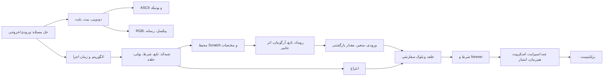

# هفتهٔ ۰ — Scratch

**عنوان رسمی:** Week 0 Scratch · **دوره:** CS50x 2026 (Harvard University، David J. Malan)

> **وضعیت این صفحه:** نمای کلی هفته با برچسب‌گذاری منبع. خلاصهٔ رسمی بازنویسی فارسی (translated-rewritten) است. هدف‌ها، مسیر، معیار تسلط و زمان‌بندی **تألیف CS50x Anzali** هستند (authored) و قاعدهٔ رسمی CS50 نیستند.

## مقدمه

هفتهٔ ۰ دروازهٔ ورود به CS50 است. هنوز کد متنی نمی‌نویسی. اول می‌فهمی کامپیوتر اطلاعات را چطور با صفر و یک نمایش می‌دهد، الگوریتم و شبه‌کد چیست، و بعد با **Scratch**، زبان برنامه‌نویسی بصری MIT، همان مفاهیم را به‌شکل بلوک‌های رنگی می‌سازی. هفته با پرابلم‌ست ۰ تمام می‌شود: ساختن یک پروژهٔ دلخواه در Scratch.

## خلاصهٔ رسمی (بازنویسی فارسی)

فهرست مباحث صفحهٔ رسمی هفته ([weeks/0](https://cs50.harvard.edu/x/weeks/0/)) به فارسی:

- علوم کامپیوتر (Computer Science) و تفکر محاسباتی (Computational Thinking)
- حل مسئله: ورودی‌ها و خروجی‌ها (Problem Solving: Inputs, Outputs)
- بازنمایی اطلاعات (Representation): یکانی (Unary)، دودویی (Binary)، دهدهی (Decimal)، اَسکی (ASCII)، یونیکد (Unicode)، RGB
- انتزاع (Abstraction)
- الگوریتم‌ها (Algorithms) و زمان اجرا (Running Times)
- شبه‌کد (Pseudocode)
- Scratch: تابع‌ها، آرگومان‌ها و مقدارهای بازگشتی (Functions, Arguments, Return Values)؛ متغیرها (Variables)؛ عبارت‌های بولی و شرط‌ها (Boolean Expressions, Conditionals)؛ حلقه‌ها (Loops)؛ رویدادها (Events)؛ ریسه‌ها (Threads)

## چرا این هفته مهم است

- هر چیزی که بعداً در C، Python یا SQL می‌نویسی روی همین چند بلوک سازنده بنا می‌شود: تابع، شرط، عبارت بولی، حلقه و متغیر.
- درس‌نامه تأکید می‌کند که حتی در دوران هوش مصنوعی، دانستن اصول تو را «راننده» نگه می‌دارد ([خوش آمدید](/kb/d/w00-n01)).
- Scratch به تو اجازه می‌دهد منطق را بدون دردسرِ نحو (syntax) تمرین کنی.

## هدف‌های یادگیری (قابل سنجش، تألیفی)

در پایان این هفته باید بتوانی:

1. **(w00-o01)** یک عدد ۰ تا ۲۵۵ را به دودویی ۸ بیتی و برعکس تبدیل کنی. سنجش: سؤال‌های کوییز با مفهوم `w00-c-binary` یا `w00-c-byte`، حداقل ۸۰٪ درست.
2. **(w00-o02)** توضیح بدهی ASCII، یونیکد و RGB چطور متن و رنگ را با عدد نمایش می‌دهند، و نشان بدهی یک الگوی بیت بسته به زمینه چند معنا دارد.
3. **(w00-o03)** سه الگوریتم دفترچهٔ تلفن را مقایسه کنی و برای هر کدام رشد `n`، `n/2` یا `log₂ n` را مشخص کنی.
4. **(w00-o04)** برای یک مسئلهٔ روزمره شبه‌کد بنویسی که حداقل یک شرط، یک حلقه و یک حالت مرزی داشته باشد.
5. **(w00-o05)** در یک شبه‌کد یا اسکریپت Scratch، تابع، شرط، عبارت بولی و حلقه را شناسایی کنی.
6. **(w00-o06)** بخش‌های محیط Scratch و دستگاه مختصات صحنه را نام ببری و از آن‌ها استفاده کنی.
7. **(w00-o07)** میان آرگومان، مقدار بازگشتی و اثر جانبی در یک برنامهٔ Scratch تمایز بگذاری.
8. **(w00-o08)** کد تکراری را با `repeat` و یک بلوک سفارشی دارای ورودی بازنویسی کنی.
9. **(w00-o09)** از `forever` همراه با `if`/`else` برای بررسی پیوسته استفاده کنی و اشکال «شرط فقط یک بار بررسی شد» را تشخیص بدهی.
10. **(w00-o10)** پروژه‌ای با چند اسپرایت و چند اسکریپت هم‌زمان طراحی کنی که از متغیر برای نگه‌داشتن وضعیت (مثلاً امتیاز) استفاده کند.
11. **(w00-o11)** پرابلم‌ست ۰ (Starting from Scratch) را مطابق همهٔ الزامات رسمی بسازی و با فایل `.sb3` تحویل بدهی.
12. **(w00-o12)** سیاست صداقت علمی دوره دربارهٔ هوش مصنوعی را بیان کنی: فقط CS50 Duck مجاز است.

## پیش‌نیازها

- **رسمی:** طبق [سیلابس](https://cs50.harvard.edu/x/syllabus/)، دوره برای افراد «با یا بدون تجربهٔ قبلی برنامه‌نویسی» طراحی شده است. هفتهٔ ۰ پیش‌نیاز فنی ندارد.
- **عملی (از صفحهٔ پرابلم‌ست ۰):** حساب GitHub برای انجام Preliminary Course Setup، مرورگر Chrome (پیشنهاد رسمی) و دسترسی به [scratch.mit.edu](https://scratch.mit.edu).
- **تألیفی:** آشنایی با جمع و ضرب ساده، برای ارزش جایگاه‌ها در دودویی.

## نقشهٔ مفهومی و مسیر یادگیری

**نسخهٔ متنی همین نقشه** (پنل فعلاً mermaid را رسم نمی‌کند):

1. حل مسئله ← دودویی، بیت، بایت ← ASCII، یونیکد، RGB و رسانه
2. حل مسئله ← الگوریتم و زمان اجرا ← شبه‌کد (تابع، شرط، عبارت بولی، حلقه) ← انتزاع
3. شبه‌کد ← محیط Scratch ← رویداد و تابع ← متغیر و مقدار بازگشتی ← حلقه و بلوک سفارشی ← شرط و forever ← بازی‌سازی ← پرابلم‌ست ۰

گراف کامل مفاهیم و پیش‌نیازها در `curriculum/learning-map.json` و ترتیب درس‌ها در `weeks/week-00/curriculum.json` است.

## یادداشت‌های هفته

| # | یادداشت | بخش رسمی |
| --- | --- | --- |
| ۱ | [خوش آمدید: هوش مصنوعی و اصول](/kb/d/w00-n01) | Welcome! |
| ۲ | [VS Code و chat.py](/kb/d/w00-n02) | Visual Studio Code and chat.py |
| ۳ | [علوم کامپیوتر، حل مسئله و دودویی](/kb/d/w00-n03) | Computer Science and Problem Solving |
| ۴ | [اسکی](/kb/d/w00-n04) | ASCII |
| ۵ | [یونیکد](/kb/d/w00-n05) | Unicode |
| ۶ | [RGB و رسانه](/kb/d/w00-n06) | RGB |
| ۷ | [الگوریتم و زمان اجرا](/kb/d/w00-n07) | Algorithms |
| ۸ | [شبه‌کد](/kb/d/w00-n08) | Pseudocode |
| ۹ | [در ادامهٔ دوره](/kb/d/w00-n09) | What’s Ahead |
| ۱۰ | [محیط Scratch](/kb/d/w00-n10) | Scratch |
| ۱۱ | [سلام دنیا](/kb/d/w00-n11) | Hello World |
| ۱۲ | [سلام به تو](/kb/d/w00-n12) | Hello, You |
| ۱۳ | [میو، حلقه و انتزاع](/kb/d/w00-n13) | Meow, Loops, and Abstraction |
| ۱۴ | [شرط‌ها](/kb/d/w00-n14) | Conditionals |
| ۱۵ | [Oscartime](/kb/d/w00-n15) | Oscartime |
| ۱۶ | [Ivy’s Hardest Game](/kb/d/w00-n16) | Ivy’s Hardest Game |
| — | [جمع‌بندی هفته](/kb/d/w00-summary) | Summing Up |
| — | [راهنمای پرابلم‌ست: Starting from Scratch](/kb/d/w00-ps-scratch) | Problem Set 0 |

## زمان پیشنهادی

- **رسمی:** CS50 برای هر هفته زمان دقیقی اعلام نمی‌کند. [پرسش‌های متداول](https://cs50.harvard.edu/x/faqs/) می‌گوید زمان سخنرانی‌ها را خودت جمع بزن و برای پرابلم‌ست‌های هر هفته **بین ۱۰ تا ۲۰ ساعت** در نظر بگیر. این راهنمای کلی همهٔ هفته‌هاست و مخصوص هفتهٔ ۰ نیست.
- **مدت سخنرانی:** در منابع استخراج‌شده ثبت نشده است. متن پیاده‌شده حدود ۲۳ هزار کلمه است، که **برآورد استنتاجی** حدود ۲ تا ۲٫۵ ساعت را نشان می‌دهد. این عدد رسمی نیست.
- برای یادداشت‌ها، درس‌ها و کوییزهای این بسته **برآورد زمانی قابل دفاعی نداریم** و عددی هم اعلام نمی‌کنیم. بعد از اجرای آزمایشی با کلاس، داده جمع‌آوری کن.

## معیارهای تسلط (پیشنهادی و قابل تنظیم؛ قاعدهٔ CS50 نیست)

هفته برای یک دانش‌آموز «تسلط‌یافته» محسوب می‌شود وقتی:

1. همهٔ واحدهای درس‌های `w00-l01` تا `w00-l10` را با شرط تسلط هر واحد گذرانده باشد.
2. در **آزمون تسلط هفته** (`w00-act-mastery-test`) حداقل **۸۰٪** پاسخ درست داشته باشد، و برای هر مفهوم کلیدی دست‌کم یک پاسخ درست.
3. در **مرور فاصله‌دار** حداقل ۸۰٪ از فلش‌کارت‌های سطح ۱ و ۲ را در مرور دوم (حداقل یک روز بعد) درست به یاد آورده باشد.
4. چک‌لیست خودارزیابی پرابلم‌ست را کامل کرده و پروژه را تحویل داده باشد. نمرهٔ رسمی را check50 در سیستم CS50 تعیین می‌کند، نه این پنل.

مقدارهای دقیق در `gamification/rules.json` قابل تنظیم‌اند.

---

*Based on CS50x 2026 © David J. Malan, Harvard University (https://cs50.harvard.edu/x/), licensed CC BY-NC-SA 4.0. Persian rewrite and authored material by CS50x Anzali; same license (ShareAlike), non-commercial.*
